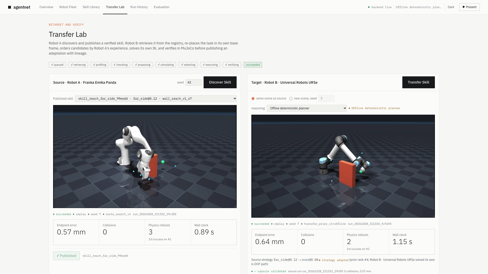
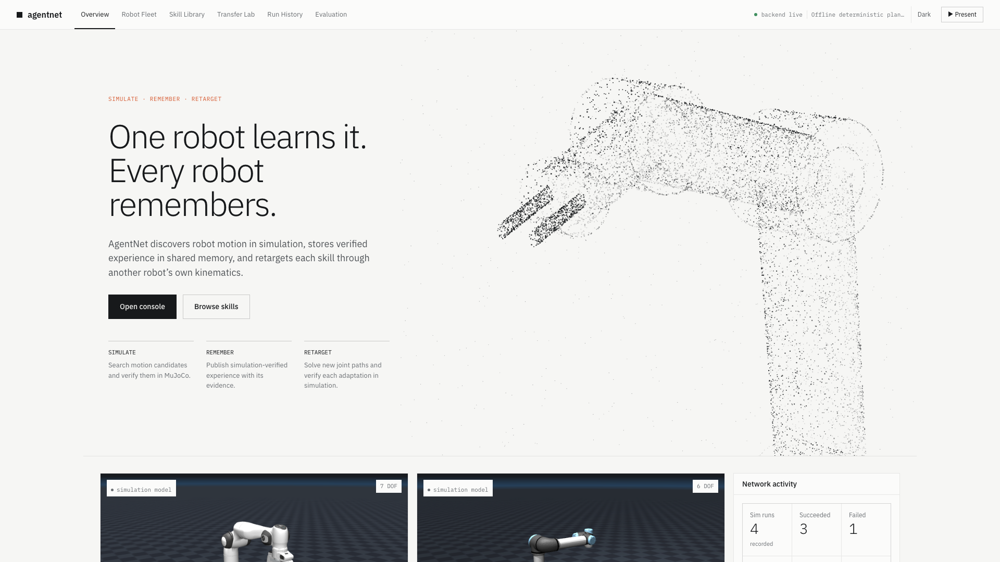
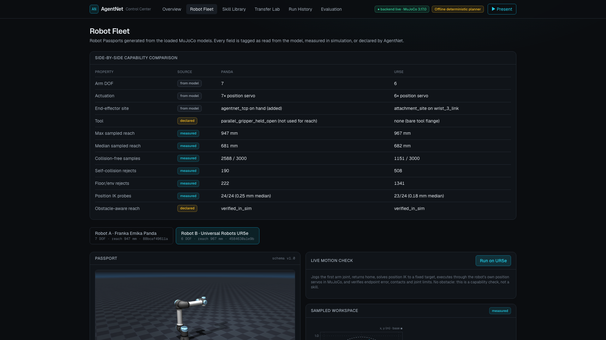
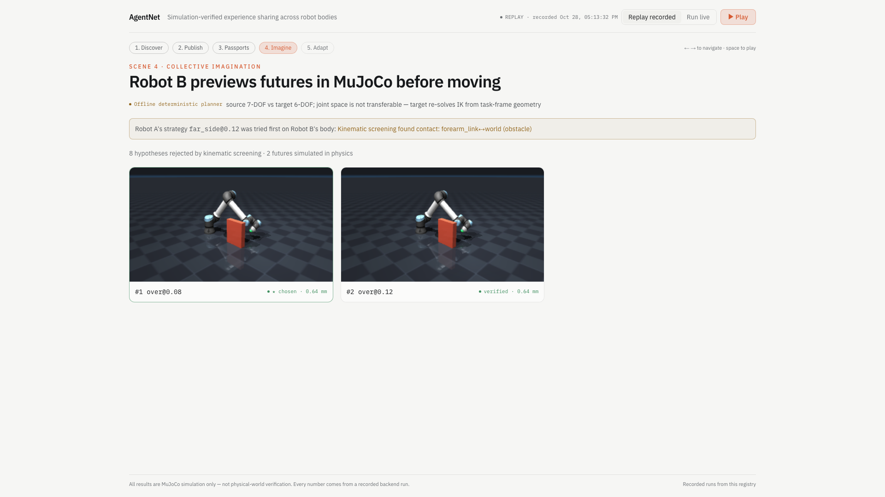
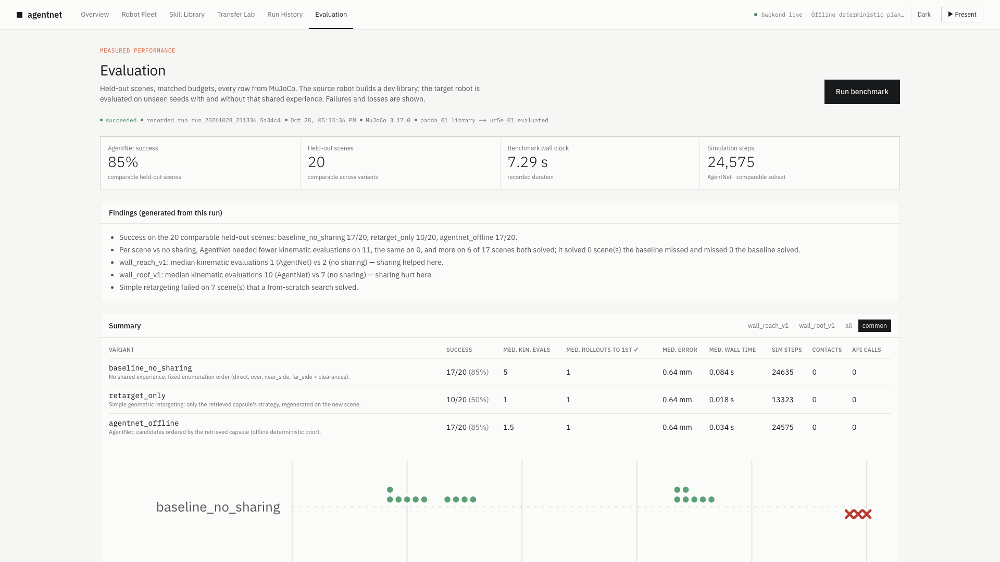

# AgentNet — Collective Intelligence for Physical AI

An interoperable, simulation-verified system for exchanging and adapting robot motion-planning
experience across different simulated embodiments. Robot A (Franka Emika Panda) discovers and
publishes a verified skill; Robot B (Universal Robots UR5e) adapts it with its own kinematics,
previews candidates in MuJoCo, and publishes the adaptation with lineage.

> **Status:** Milestones 0–6 complete, M7 engineering done (recording/submission pending) (see [PROGRESS.md](PROGRESS.md)). Meta Muse Spark is integrated and has
> made live calls (`muse-spark-1.3-contributor`, about $0.001 per transfer); see PROGRESS.md M7.
>
> **Measured result:** on 20 held-out scenes, shared experience matched a from-scratch search on success
> (17/20 each) and reduced search effort on 11 scenes but increased it on 6 (negative transfer). Plain
> retargeting solved 10/20. Details: [docs/EVALUATION.md](docs/EVALUATION.md). Everything shown is MuJoCo simulation, not
> physical-world verification.

## What works today

- Real Menagerie models (pinned commit) for Panda (7-DOF) and UR5e (6-DOF), loaded with `MjSpec`.
- `RobotAdapter` discovers arm joints, position-servo actuators and the end-effector site from the
  compiled model (no hard-coded link lengths).
- Damped-least-squares position IK with joint-limit clamping, multi-seed retries and collision rejection.
- Physics execution through each robot's own actuators (gravity-compensated servo setpoints), with
  contact, joint-limit and endpoint-error verification.
- Robot Passports with per-field provenance (`model` / `measured` / `declared`), sampled workspace
  and IK reliability probes, cached in SQLite.
- FastAPI backend with a single simulation worker thread, typed run events (SSE) and MP4 renders.
- Source skill discovery: 10 candidate routes searched with IK, collision screening, clearance and
  physics rollouts; the verified winner becomes a publishable Experience Capsule (task-frame only).
- Cross-robot transfer: the UR5e retrieves a Panda capsule from the registry, re-places the task in its own
  frame, orders candidates by the Panda's experience, solves its own IK, verifies in MuJoCo, and publishes an
  adaptation with lineage.
- Collective Imagination: a reasoning provider (offline prior, or Meta Muse Spark with `MODEL_API_KEY`) ranks
  hypotheses; MuJoCo simulates several futures before one is executed. Each run records which provider was
  used, model calls, tokens, estimated cost, and whether the model changed the selection.
- Optional controller execution: after MuJoCo verification, the UR5e path can be streamed to **URSim** (UR's
  controller software, PolyScope 5.26) through a `ur_rtde` bridge. The run records what the controller reported.
  Labelled "URSim controller, not physical". See [backend/ur_bridge/README.md](backend/ur_bridge/README.md).
- Next.js Control Center: Overview, Robot Fleet, Transfer Lab (Panda ↔ UR5e), Skill Library, Run History,
  and a one-click **Presentation mode** (`/present`) that replays a recorded chain or runs it live.
  See [docs/DEMO_SCRIPT.md](docs/DEMO_SCRIPT.md).



## Quick start

Requirements: macOS/Linux, Python 3.11+ (tested 3.13; override with `PYTHON=python3.11 make setup`),
Node 20+ (tested 24), git, network access for the first setup (pip, npm, MuJoCo Menagerie, Playwright Chromium).

```bash
make setup     # venv + backend deps, pinned Menagerie models, frontend deps
make smoke     # loads both robots, jogs a joint, executes an IK reach, renders MP4s
make test      # backend unit/integration/API tests
make discover  # headless: Panda discovers + publishes a skill on seed 42
make transfer  # headless: Panda skill (seed 7) transferred to the UR5e (also seeds replay data)
make benchmark # held-out evaluation; writes docs/EVALUATION_RESULTS.md from the stored run
make e2e       # Playwright UI tests on an isolated stack (ports 8011/3011, temp DB)
make demo-check && make demo-seed && make demo   # recording: stability check, clean registry, prod build
make dev       # backend http://127.0.0.1:8000 + frontend http://localhost:3000
```

Copy `.env.example` to `.env` to configure. With no `MODEL_API_KEY` the app runs in the clearly
labelled **Offline deterministic planner** mode.

## Screens

| | |
|---|---|
|  |  |
|  |  |

## Layout

```
backend/app/services   robot_catalog, scene, robot_adapter, kinematics, simulation, render,
                       passports, fleet, registry, jobs, motion_check, task_scene,
                       route_planner, candidate_search, skill_discovery, transfer, imagination,
                       capsules, skill_registry, reasoning/{base,offline,meta_muse}, librarian/offline,
                       controller/{bridge_client,execution}
backend/app/api        health, robots, runs (incl. discover), skills, transfers, library, controller
backend/ur_bridge      ur_rtde HTTP bridge + URSim compose file (make ursim-up)
backend/scripts        fetch_models.sh, smoke_sim.py, discover_skill.py, transfer_demo.py
backend/tests          passport, IK/physics, registry, API
frontend/              Next.js 16 App Router + Tailwind 4
docs/                  ARCHITECTURE.md, DEMO_SCRIPT.md, EVALUATION.md, EVALUATION_RESULTS.md,
                       KNOWN_LIMITATIONS.md
frontend/e2e/          Playwright UI tests
```

## Attribution

Robot models from [MuJoCo Menagerie](https://github.com/google-deepmind/mujoco_menagerie)
(Franka Emika Panda and Universal Robots UR5e, each under its own license in the model directory),
fetched at a pinned commit and not redistributed in this repository.
